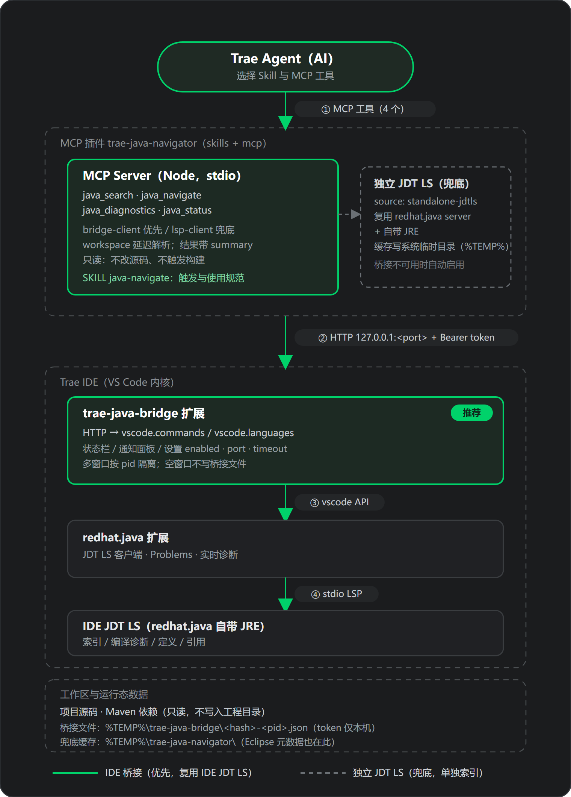

# Trae Java Navigator

<p align="center">
  <a href="https://github.com/lianghujun/trae-java-navigator/blob/main/.trae-plugin/plugin.json"></a>
  <a href="https://github.com/lianghujun/trae-java-navigator/blob/main/server/mcp-server.js"></a>
  <a href="https://github.com/lianghujun/trae-java-navigator/tree/main/skills"></a>
  <a href="https://github.com/lianghujun/trae-java-navigator#platform-compatibility"></a>
  <a href="https://github.com/lianghujun/trae-java-navigator/commits/main"></a>
  <a href="https://github.com/lianghujun/trae-java-navigator/stargazers"></a>
  <a href="https://github.com/lianghujun/trae-java-navigator/blob/main/LICENSE"></a>
</p>

<p align="center">
  English | <a href="./README.md">简体中文</a>
</p>

<p align="center">
  <b>Compiler-accurate Java symbol navigation for AI — faster and more precise than grep + find + read</b><br/>
  Symbol lookup · definition/references · live diagnostics · 4 MCP tools · 1 Skill
</p>

<p align="center">
  Companion IDE extension: <a href="https://github.com/lianghujun/trae-java-bridge">trae-java-bridge</a>
</p>

<p align="center">
  Reuses the IDE's running JDT LS first · falls back to a standalone JDT LS · read-only, never writes to your project
</p>

## Quick Start

> **AGENT NOTE**: To install this plugin for Trae, run `node install.mjs` in the repository root; it installs the MCP plugin and the bundled bridge extension, then asks the user to fully restart Trae. If it fails, follow the Troubleshooting section — do not ask the user to copy files manually.

```powershell
node install.mjs
```

One command does three things:

1. Installs the MCP plugin into `~/.trae-cn/plugins/local/`, including 4 MCP tools and the `java-navigate` Skill
2. Installs the bundled bridge extension `vendor/trae-java-bridge.vsix` (when an IDE CLI is found)
3. Asks you to fully restart Trae

**The Skill needs no separate installation**: it is registered together with the plugin and appears as `java-navigate` after restart. It triggers automatically for Java symbol lookups, reference searches and compiler error investigations, and can also be invoked by name. Skills are part of the Trae plugin mechanism and **only work in Trae CN / Trae**; VS Code / Cursor have no plugin or skill system, so the MCP server must be configured manually (see Platform Compatibility).

> The extension can also be installed on its own: run `npm run package:vsix` in `D:\trae-java-bridge-extension`, then `node install.mjs --vsix dist/trae-java-bridge.vsix`.

## Platform Compatibility

| Environment | Plugin | Extension | Notes |
|---|---|---|---|
| Trae CN / Trae | ✅ | ✅ | Recommended; reuses the IDE's JDT LS; Skill auto-registered |
| VS Code / Cursor etc. | Manual MCP config | ✅ | No Trae plugin/skill system: point your MCP client at `server/mcp-server.js`; `java-navigate` is not loaded automatically |
| No IDE | ✅ | — | Falls back to a standalone JDT LS; the first run waits for indexing |

## How It Works (Hybrid)

```text
Preferred: in-IDE bridge (trae-java-bridge VSIX)
      → reuses the IDE's running redhat.java / JDT LS
      → live diagnostics + an already-built index, no duplicate indexing

Fallback: standalone JDT LS (reuses redhat.java's server and bundled JRE)
      → enabled automatically when the VSIX is missing or inactive
      → costs a duplicate index and a first-run wait
```

## Layout

```text
trae-java-navigator/             MCP plugin (skills + mcp)
  server/mcp-server.js
  server/bridge-client.js        ← probes the IDE bridge first
  server/lsp-client.js           ← fallback: standalone JDT LS
  server/jdtls.js
  skills/java-navigate/SKILL.md  ← registered with the plugin, no separate install

trae-java-bridge-extension/     Trae/VS Code extension (VSIX or directory install)
  extension.js                   ← calls vscode.languages / vscode.commands
```

## Overall Relationship



Key points:

- **Skill and MCP complement each other**: the Skill only decides when and how to use the tools; the actual query power comes from the MCP server
- **Bridge first**: reuses the IDE's warm index and live diagnostics, no duplicate indexing
- **Graceful fallback**: if the bridge is missing, times out or returns 5xx, the MCP server switches to the standalone JDT LS and records the reason in `java_status.bridgeError`
- **Write isolation**: bridge files live in the system temp directory, index caches live in temp, project directories remain read-only

## Installation Details

- Install directory: `~/.trae-cn/plugins/local/trae-java-navigator/<version>/`; override with `--plugins-root <dir>` or `TRAE_PLUGINS_ROOT`
- `.mcp.json` uses the relative entry `./server/mcp-server.js`; Trae starts the MCP process with the plugin directory as cwd
- Upgrades clean old version directories automatically; if the plugin is in use and its directory is locked, files are overwritten and a restart is required
- `.ps1` is only a Windows convenience wrapper that delegates to `.mjs`
- Uninstall: `node uninstall.mjs` (removes the plugin directory, fallback caches and bridge leftovers)

## Distribution

- **MCP plugin**: a Trae local plugin is a "directory + `.success` marker" with no CLI install command. The release artifact is a directory archive (containing `install.mjs` / `.trae-plugin` / `.mcp.json` / `server` / `skills`); unpack it and run `node install.mjs`. The version lives in `.trae-plugin/plugin.json`, and installs are isolated per `<name>/<version>` so upgrades never overwrite old files. VS Code / Cursor have no Trae plugin mechanism: point their MCP client at `server/mcp-server.js` manually and the Skill will not be registered.
- **Bridge extension**: a standard VS Code extension; the artifact is a `.vsix` (`npm run package:vsix`). Install with `node install.mjs --vsix <file>`; enable/disable/uninstall state is managed by the IDE itself. You can also use "Install from VSIX" in the extension panel.
- Before a public release, change `publisher` from `local` to a real publisher; otherwise only sideloading works and the extension cannot be listed on a gallery.
- Upgrades: the installer deletes old directories of the same plugin/extension before copying, so the IDE never sees multiple versions.

## Enable / Disable / Uninstall

| Action | Behavior |
|---|---|
| Enable MCP plugin | Trae starts `node server/mcp-server.js` from `.mcp.json`; tools appear in the MCP list |
| Enable Skill | Registered with the plugin, no separate switch; appears as `java-navigate` after restart and disappears when the plugin is disabled |
| Disable MCP plugin | Trae closes stdio; the MCP process stops the JDT LS child process and exits on stdin end/close, leaving no orphans |
| Enable extension | Triggered by `onStartupFinished`; listens on a random 127.0.0.1 port and writes the bridge file |
| Disable extension | VS Code calls `deactivate()` → closes the HTTP server, deletes the bridge file and empty directories; the MCP server immediately falls back to the standalone JDT LS |
| Uninstall extension | Recommended: `node uninstall.mjs` (prefers the IDE CLI, otherwise deletes the directory, cleans the `extensions.json` entry and removes this project's bridge files) |
| Uninstall MCP plugin | `node uninstall.mjs` removes the plugin directory and the fallback JDT LS cache (`%TEMP%\trae-java-navigator`, possibly hundreds of MB) |

- Whether enable/disable takes effect immediately depends on the IDE: Trae usually needs a **Reload Window** for extension changes; MCP plugin install/upgrade/uninstall requires **fully quitting and restarting Trae** so the main process rescans the plugin directory.
- If a window crashes without `deactivate`, leftover bridge files are cleaned by the MCP server on the next scan using a pid liveness check, so it never connects to a dead instance.

## Verification

Ask the AI to call:

```text
java_status
```

- `"source": "ide-bridge"`: the IDE's JDT LS is being reused — live diagnostics, no duplicate indexing.
- `"source": "standalone-jdtls"`: the bridge extension is inactive and the fallback JDT LS is running (the first run waits for indexing).

Then call:

```text
java_search { "query": "QualityController" }
java_search { "file": "<some Controller.java>", "name": "getRule" }
java_diagnostics { "severity": "error" }
```

Skill check (Trae only): `java-navigate` appears in the skill list (registered with the plugin, no separate install); or simply say "use the java-navigate skill to find getRule". VS Code / Cursor require manual MCP configuration and have no such skill.

## Tools

Only 4 tools cover all capabilities, keeping context usage low:

| Tool | Purpose |
|---|---|
| `java_search` | `query` = workspace search (supports `Class#method`); `class` + `name` = locate inside a class; `file` + `name` = locate inside a file; `file` only = file outline |
| `java_navigate` | `action=definition` (includes the source line) / `references` / `hover` |
| `java_diagnostics` | Pass `file` for one file, omit it for the whole workspace |
| `java_status` | Data source, index state, dependency probing; `warmup=true` starts indexing in the background |

Line and column numbers are **1-based**; `file` accepts absolute paths or workspace-relative paths. Results include a `summary` text line — read that first.

## Skill (java-navigate)

The plugin ships 1 Skill (`skills/java-navigate/SKILL.md`), registered with the plugin, with **no separate installation or configuration**.

| Item | Details |
|---|---|
| Scope | Only the Trae CN / Trae plugin mechanism registers Skills; VS Code / Cursor have no such mechanism and need manual MCP configuration plus their own usage rules |
| Purpose | Tells the AI when and how to use the 4 tools; requires MCP tools first for Java symbol lookup and forbids Grep/rg/Read as the first choice |
| Trigger | Loaded automatically for Java class/method/field lookups, definition jumps, reference searches and compiler error investigations; can also be invoked by name |
| Boundary | The Skill only provides usage rules, not query capability; the data comes from the MCP tools, so it is enabled and disabled with the plugin |
| Verify | After restarting Trae, `java-navigate` appears in the skill list; or ask the AI to "use the java-navigate skill to find method X" |
| Maintenance | `SKILL.md` must keep the YAML frontmatter `name` / `description`; without them Trae skips registration |

## Bridge Protocol

The extension writes a rendezvous file at `%TEMP%\trae-java-bridge\<workspace-hash>-<pid>.json` (`$TMPDIR` on macOS/Linux):

```json
{ "port": 55114, "token": "...", "pid": 9144,
  "windowId": "window-session-id",
  "workspaceFolders": ["<workspace-folder>"],
  "appName": "Trae CN", "appHost": "desktop",
  "redhatJavaPath": "...\\redhat.java-1.58.0-win32-x64", "redhatJavaActive": true,
  "lombokExtension": "vscjava.vscode-lombok", "lombokJar": "...\\lombok-1.18.39.jar",
  "startedAt": "..." }
```

The MCP server reads the file, verifies pid/token, then calls:

```text
GET /diagnostics?file=&severity=
GET /symbols?query=&limit=
GET /definition?file=&line=&column=
GET /references?file=&line=&column=
GET /documentSymbols?file=
GET /hover?file=&line=&column=
```

It only listens on `127.0.0.1` with a random port and a Bearer token; nothing is exposed to the network.

## Configuration

| Environment variable | Purpose | Default |
|---|---|---|
| `JAVA_NAV_WORKSPACE` | Java workspace root | Auto-detected: `JAVA_NAV_WORKSPACE` → IDE-injected workspace variables → workspace reported by the bridge → current directory → a Java project in first-level subdirectories |
| `JAVA_NAV_BRIDGE_DIR` | Bridge file directory | `%TEMP%\trae-java-bridge` (same as the extension) |
| `JAVA_NAV_IDE_HOME` / `TRAE_HOME` | IDE user data directory | Scans Trae CN / Trae / VS Code / Cursor / VSCodium |
| `JDTLS_HOME` / `REDHAT_JAVA_HOME` | `server` directory of the fallback JDT LS | Scans `redhat.java-*` in each IDE's extension directory |
| `TRAE_USER_SETTINGS` | Explicit user `settings.json` | Scans the User directory of each IDE |
| `TRAE_JAVA_NAV_CACHE` | Fallback JDT LS cache directory | System temp directory |
| `JAVA_NAV_BRIDGE_TIMEOUT` | MCP → bridge request timeout (ms) | `20000` |
| `JAVA_NAV_LSP_INIT_TIMEOUT` | Maximum wait for fallback JDT LS init (ms) | `60000` |
| `LOMBOK_JAR` | Explicit lombok agent jar | Auto-detected from redhat.java / the Lombok extension |
| `TRAE_JAVA_BRIDGE_DIR` | Extension-side bridge file directory | Same as `JAVA_NAV_BRIDGE_DIR` |

## Lifecycle and Fallback

- **Multi-window isolation**: each IDE window runs its own extension host process; bridge files are named `workspace-hash-pid.json` and carry `windowId`, `appName` and `process.pid` in the payload. Multiple windows on the same workspace never overwrite each other.
- **Cleanup of stale files**: leftover bridge files from crashed windows are deleted by the MCP server on the next scan via a pid liveness check; a normal close deletes them in `deactivate`.
- **Workspace changes**: adding or removing folders rewrites the bridge file and deletes the old one, so the MCP server never connects to an outdated workspace.
- **Timeouts and fallback**: on timeout or 5xx the MCP server falls back to the standalone JDT LS and records the reason in `java_status.bridgeError`; each IDE command on the extension side has a 15 s cap (`TRAE_JAVA_BRIDGE_TIMEOUT`) to avoid hanging during indexing.
- **Retryable initialization**: after a failed or timed-out fallback JDT LS init, the init state is cleared so the next call retries instead of hanging forever; `status` reports `InitError: ...`.
- **Dependency reporting**: `java_status.redhatJava` exposes whether redhat.java exists/is active; `java_status.lombok` exposes the Lombok agent and extension probe results.

## Lombok

- In fallback mode the JDT LS is started with the lombok agent attached: `LOMBOK_JAR` first, then redhat.java's bundled `lombok/lombok-*.jar`, then the jar inside the `vscjava.vscode-lombok` / `gabrielbb.vscode-lombok` extension.
- In bridge mode the IDE's redhat.java + Lombok extension handle it; the MCP server only probes and reports.
- Members generated by Lombok are part of IDE diagnostics; the Maven build result remains authoritative.

## Relationship to the Build Gate

IDE diagnostics are for **fast localization** and cannot replace compilation:

- JDT LS classpaths, annotation processors and generated sources are not identical to Maven (especially for Lombok, MapStruct, protobuf, etc.).
- The final gate must be a Maven build, e.g. `mvnw -DskipTests test-compile`; to avoid incremental-build leftovers, run `mvnw clean -DskipTests test-compile` first.
- The tools are read-only: they never trigger builds or modify sources.

## Write Locations

Neither project modifies sources or triggers builds; all runtime data lives outside the project directory:

| Writer | Path | Content |
|---|---|---|
| Bridge extension | `%TEMP%\trae-java-bridge\<hash>-<pid>.json` | Port, token, window/workspace info; deleted when the window closes |
| MCP plugin | `%TEMP%\trae-java-navigator\` (override with `TRAE_JAVA_NAV_CACHE`) | Index/workspace caches for the fallback JDT LS |
| MCP plugin | `TRAE_PLUGIN_DATA_DIR` injected by Trae | Only passed as an env var; the plugin never writes there |
| Fallback JDT LS | `.metadata` inside the cache directory above | Eclipse/JDT metadata |

The fallback JDT LS is started with `-Djava.import.generatesMetadataFilesAtProjectRoot=false` (verified: importing a Maven project does not create `.project` / `.classpath` / `.factorypath` / `.settings` at the project root). It only writes back to the project root if the user explicitly sets `java.import.generatesMetadataFilesAtProjectRoot` to `true`.

In bridge mode, metadata is managed by the IDE's redhat.java under `globalStorage/redhat.java/...`, also outside the project directory.

## Portability

- **No project-name assumptions**: nothing is hard-coded to a specific repository or module; the Java project is located by `JAVA_NAV_WORKSPACE` → IDE workspace variables → workspace reported by the bridge → a `pom.xml`, `build.gradle` or `src/main/java` in the current directory / first-level subdirectories.
- **No Trae install-path dependency**: the fallback JDT LS prefers the `redhat.java` location reported by the bridge, then scans Trae CN / Trae / VS Code / Cursor / VSCodium extension directories; `JDTLS_HOME` can override.
- **No fixed bridge home**: the extension and MCP server rendezvous through the system temp directory, avoiding hard-coded `~/.trae-cn`.
- **Multi-IDE user settings**: reads `settings.json` from Trae CN, Trae, Code, Cursor and VSCodium on Windows/macOS/Linux, overridable with `TRAE_USER_SETTINGS`.
- **Adaptive install scripts**: `install.ps1` / `install-bridge.ps1` detect the current IDE's plugin/extension directories, or accept `-PluginsRoot` / `-ExtensionsRoot`.
- **Relative MCP entry**: `.mcp.json` always uses `./server/mcp-server.js`. Trae starts the MCP process with the plugin version directory as cwd, so upgrades that change the directory (`0.1.1` → `0.2.0`) do not break absolute paths; the installer verifies it stays relative.

## Troubleshooting

- Always `standalone-jdtls`: confirm the `local.trae-java-bridge` extension is enabled; after a Reload, check whether `%TEMP%\trae-java-bridge\` contains a file.
- Skill list has no `java-navigate`: fully restart Trae and check the YAML frontmatter (`name` / `description`) in `skills/java-navigate/SKILL.md`.
- The AI still uses Grep first: ask it explicitly to "use the java-navigate skill", and confirm the 4 MCP tools appear in the tool list.
- Bridge returns 401 / connection failure: the MCP server falls back to the standalone JDT LS automatically and logs the reason to stderr.
- `java_search` reports "index not ready": the fallback is indexing; use the bridge or retry later.
- JDT LS exits with `UnsupportedClassVersionError`: the plugin automatically picks redhat.java's bundled JRE (21+).
- `AccessDeniedException` because the config directory is read-only: the plugin copies `config_win` into a writable cache directory before starting.

## License

[MIT](LICENSE) © 2026 lianghujun

Our own code is released under MIT; runtime dependencies such as redhat.java / JDT LS (EPL-2.0) and Lombok (MIT) follow their own licenses and are not redistributed in this repository.

## Disclaimer

This project is a third-party open-source plugin developed for TRAE. TRAE is a registered trademark of its respective owner. This project is not affiliated with, sponsored by, certified by or partnered with TRAE officially. All trademark rights belong to their respective owners.

## Support the Author

If this project helps you, you are welcome to scan the QR code and buy the author a coffee. Your support keeps the project maintained and updated.

<p align="center">
  
</p>

> Note: this is a voluntary donation, not a commercial transaction; no invoices or commercial support are provided.