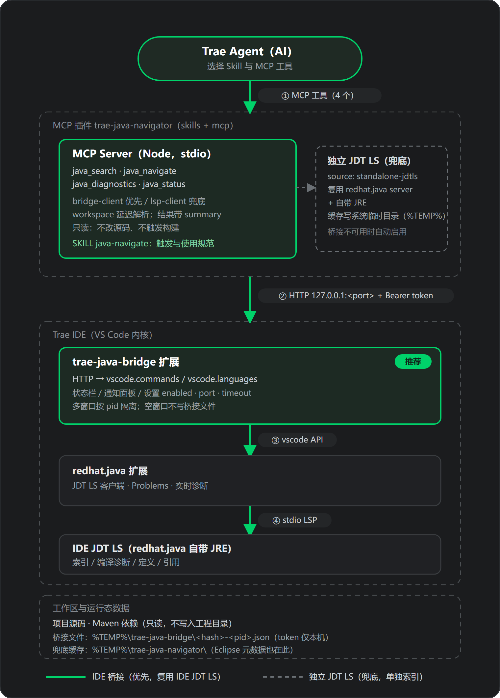

# Trae Java Navigator

<p align="center">
  <a href="https://github.com/lianghujun/trae-java-navigator/blob/main/.trae-plugin/plugin.json"></a>
  <a href="https://github.com/lianghujun/trae-java-navigator/blob/main/server/mcp-server.js"></a>
  <a href="https://github.com/lianghujun/trae-java-navigator/tree/main/skills"></a>
  <a href="https://github.com/lianghujun/trae-java-navigator#平台兼容"></a>
  <a href="https://github.com/lianghujun/trae-java-navigator/commits/main"></a>
  <a href="https://github.com/lianghujun/trae-java-navigator/stargazers"></a>
  <a href="https://github.com/lianghujun/trae-java-navigator/blob/main/LICENSE"></a>
</p>

<p align="center">
  <b>让 AI 用编译器级精度定位 Java 符号，比 grep + find + read 更快、更准</b><br/>
  符号定位 · 定义/引用 · 实时编译诊断 · 4 个 MCP 工具 · 1 个 Skill
</p>

<p align="center">
  配套 IDE 扩展：<a href="https://github.com/lianghujun/trae-java-bridge">trae-java-bridge</a>
</p>

<p align="center">
  优先复用 IDE 已运行的 JDT LS · 桥接不可用时自动回退独立 JDT LS · 只读，不写工程目录
</p>

## 快速开始

> **AGENT 提示**：请为 Trae 安装当前插件：在仓库根目录直接执行 `node install.mjs`；它会安装 MCP 插件与随包桥接扩展，成功后提示用户完全重启 Trae。失败时按本文“排障”处理，不要让用户手动复制文件。

```powershell
node install.mjs
```

一条命令完成：

1. 安装 MCP 插件到 `~/.trae-cn/plugins/local/`：含 4 个 MCP 工具与 `java-navigate` Skill
2. 安装随包携带的桥接扩展 `vendor/trae-java-bridge.vsix`（找到 IDE CLI 时）
3. 提示完全重启 Trae

**Skill 无需单独安装**：它随插件一起注册，重启后在技能列表中显示为 `java-navigate`；涉及 Java 符号定位、引用查找、编译错误排查时自动触发，也可在对话中直接点名“用 java-navigate 技能”。Skill 属于 Trae 插件机制，**仅 Trae CN / Trae 支持**；VS Code / Cursor 没有插件与技能系统，只能手动配置 MCP（见平台兼容）。

> 扩展也可单独安装：在 `D:\trae-java-bridge-extension` 执行 `npm run package:vsix`，再 `node install.mjs --vsix dist/trae-java-bridge.vsix`。

## 平台兼容

| 环境 | 插件 | 扩展 | 说明 |
|---|---|---|---|
| Trae CN / Trae | ✅ | ✅ | 推荐组合，复用 IDE 的 JDT LS；Skill 自动注册 |
| VS Code / Cursor 等 | 手动配置 MCP | ✅ | 无 Trae 插件与 Skill 机制：需在 MCP 客户端手动指向 `server/mcp-server.js`，`java-navigate` 不会自动加载 |
| 无 IDE | ✅ | — | 自动回退独立 JDT LS，首次需等待索引 |

## 工作原理（混合模式）

```text
优先：IDE 内部桥（trae-java-bridge VSIX）
      → 复用 IDE 已运行的 redhat.java / JDT LS
      → 实时 diagnostics + 已建好的索引，无重复索引

兜底：独立 JDT LS（复用 redhat.java 的 server 与自带 JRE）
      → 未安装/未激活 VSIX 时自动启用
      → 代价是重复索引与首次等待
```

## 组成

```text
trae-java-navigator/             MCP 插件（skills + mcp）
  server/mcp-server.js
  server/bridge-client.js        ← 优先探测 IDE 桥
  server/lsp-client.js           ← 兜底：独立 JDT LS
  server/jdtls.js
  skills/java-navigate/SKILL.md  ← 随插件注册，无需单独安装

trae-java-bridge-extension/     Trae/VS Code 扩展（VSIX 或目录安装）
  extension.js                   ← 调用 vscode.languages / vscode.commands
```

## 整体关系



关键点：

- **Skill 与 MCP 互补**：Skill 只决定“何时用、怎么用”，真正的查询能力来自 MCP 工具
- **优先桥接**：复用 IDE 已建好的索引与实时诊断，无重复索引
- **失败可降级**：桥接缺失、超时或返回 5xx 时自动切独立 JDT LS，原因记录在 `java_status.bridgeError`
- **写入隔离**：桥接文件在系统临时目录，索引缓存在临时目录，工程目录只读

## 安装细节

- 安装目录：`~/.trae-cn/plugins/local/trae-java-navigator/<version>/`；可用 `--plugins-root <dir>` 或 `TRAE_PLUGINS_ROOT` 指定
- `.mcp.json` 使用相对入口 `./server/mcp-server.js`，Trae 以插件目录为 cwd 启动
- 升级会自动清理旧版本目录；插件启用中目录被占用时覆盖安装并提示重启
- `.ps1` 只是 Windows 便捷入口，内部转调 `.mjs`
- 卸载：`node uninstall.mjs`（清理插件目录、兜底缓存与桥接残留）

## 发行

- **MCP 插件**：Trae 本地插件是“目录 + `.success` 标记”，没有 CLI 安装命令。发行物 = 目录压缩包（含 `install.mjs` / `.trae-plugin` / `.mcp.json` / `server` / `skills`），接收方解压后执行 `node install.mjs`。版本号写在 `.trae-plugin/plugin.json`，安装目录按 `<name>/<version>` 隔离，升级不会覆盖旧版本文件。VS Code / Cursor 没有 Trae 插件机制，只能把 `server/mcp-server.js` 手动配置到其 MCP 客户端，Skill 不会注册。
- **桥接扩展**：标准 VS Code 扩展，发行物 = `.vsix`（`npm run package:vsix`）。接收方执行 `node install.mjs --vsix <file>`，由 IDE 的 `--install-extension` 完成登记，enable/disable/卸载状态由 IDE 自身管理；也可在 IDE 扩展面板“从 VSIX 安装”。
- 正式对外发布前需要把 `publisher` 从 `local` 改成真实 publisher，否则只能侧载（sideload），不能上架 gallery。
- 升级：安装脚本在复制前会删除同插件/同扩展的旧版本目录，避免 IDE 同时看到多个版本。

## 启用 / 停用 / 卸载

| 动作 | 行为 |
|---|---|
| 启用 MCP 插件 | Trae 按 `.mcp.json` 启动 `node server/mcp-server.js`；工具出现在 MCP 列表 |
| 启用 Skill | 随插件注册，无单独开关；重启后技能列表出现 `java-navigate`，插件停用时一并失效 |
| 停用 MCP 插件 | Trae 关闭 stdio，MCP 进程收到 stdin 结束/关闭后停止 JDT LS 子进程并退出，不留孤儿进程 |
| 启用扩展 | `onStartupFinished` 触发，监听 127.0.0.1 随机端口并写桥接文件 |
| 停用扩展 | VS Code 调用 `deactivate()` → 关闭 HTTP 服务、删除桥接文件、空目录一并删除；MCP 立即回退独立 JDT LS |
| 卸载扩展 | 推荐 `node uninstall.mjs`（优先走 IDE CLI，回退为删除目录 + 清理 `extensions.json` 登记项 + 删除本项目桥接文件） |
| 卸载 MCP 插件 | `node uninstall.mjs` 删除插件目录，并清理兜底 JDT LS 缓存（`%TEMP%\trae-java-navigator`，可能数百 MB） |

- 启停是否“立即生效”取决于 IDE：Trae 对扩展启停通常要求 **Reload Window**；MCP 插件的安装/升级/卸载需要**完全退出并重启 Trae**，主进程才会重新扫描插件目录并重写 MCP 配置。
- 窗口崩溃（未走 `deactivate`）时，残留桥接文件会在 MCP 下次扫描时按 pid 存活检测删除，不会连到死实例。

## 验证

让 AI 调用：

```text
java_status
```

- 返回 `"source": "ide-bridge"`：已复用 IDE 的 JDT LS，实时诊断、无重复索引。
- 返回 `"source": "standalone-jdtls"`：桥接扩展未激活，正在用兜底 JDT LS（首次需等索引）。

再调用：

```text
java_search { "query": "QualityController" }
java_search { "file": "<某 Controller.java>", "name": "getRule" }
java_diagnostics { "severity": "error" }
```

Skill 生效确认（仅 Trae）：技能列表中出现 `java-navigate`（随插件注册，无需单独安装）；也可直接说“用 java-navigate 技能查找 getRule”。VS Code / Cursor 需手动配置 MCP，无此技能。

## 工具

只有 4 个工具，覆盖全部能力，避免占用过多上下文：

| 工具 | 作用 |
|---|---|
| `java_search` | `query`=工作区（支持 `Class#method`）；`class`+`name`=类内定位；`file`+`name`=文件内定位；只给 `file`=文件结构 |
| `java_navigate` | `action=definition`（含源码行）/ `references` / `hover` |
| `java_diagnostics` | 给 `file` 查单文件，省略则查整个工作区 |
| `java_status` | 数据源、索引状态、依赖探测；`warmup=true` 后台启动索引 |

行列号统一 **1-based**；`file` 支持绝对路径或相对工作区路径。结果都带 `summary` 文本行，优先读 summary。

## Skill（java-navigate）

插件内置 1 个 Skill（`skills/java-navigate/SKILL.md`），随插件一起注册，**无需单独安装或配置**。

| 项 | 说明 |
|---|---|
| 适用范围 | 仅 Trae CN / Trae 的插件机制会注册 Skill；VS Code / Cursor 无此机制，需手动配置 MCP 并自行说明使用规则 |
| 作用 | 告诉 AI 何时用、如何用这 4 个工具；规定查找 Java 符号必须先调用 MCP 工具，禁止把 Grep/rg/Read 作为首选 |
| 触发 | 任务涉及 Java 类/方法/字段定位、定义跳转、引用查找、编译错误排查时自动加载；也可在对话中直接点名 |
| 边界 | Skill 只提供使用规范，不提供查询能力；数据来自 MCP 工具，因此与插件同启同停 |
| 确认生效 | 重启 Trae 后技能列表中出现 `java-navigate`；或直接让 AI“用 java-navigate 查找 X 方法” |
| 维护 | `SKILL.md` 必须保留 YAML frontmatter 的 `name` / `description`，缺失时 Trae 会跳过注册 |

## 桥接协议

扩展在 `%TEMP%\trae-java-bridge\<workspace-hash>-<pid>.json`（macOS/Linux 为 `$TMPDIR`）写入：

```json
{ "port": 55114, "token": "...", "pid": 9144,
  "windowId": "window-session-id",
  "workspaceFolders": ["<workspace-folder>"],
  "appName": "Trae CN", "appHost": "desktop",
  "redhatJavaPath": "...\\redhat.java-1.58.0-win32-x64", "redhatJavaActive": true,
  "lombokExtension": "vscjava.vscode-lombok", "lombokJar": "...\\lombok-1.18.39.jar",
  "startedAt": "..." }
```

MCP Server 读取该文件并验证 pid/token，然后访问：

```text
GET /diagnostics?file=&severity=
GET /symbols?query=&limit=
GET /definition?file=&line=&column=
GET /references?file=&line=&column=
GET /documentSymbols?file=
GET /hover?file=&line=&column=
```

仅监听 `127.0.0.1`，随机端口 + Bearer token，无网络暴露。

## 配置

| 环境变量 | 作用 | 默认 |
|---|---|---|
| `JAVA_NAV_WORKSPACE` | Java 工作区根目录 | 自动探测：`JAVA_NAV_WORKSPACE` → IDE 注入的工作区环境变量 → 桥接上报的工作区 → 当前目录 → 一级子目录中的 Java 工程 |
| `JAVA_NAV_BRIDGE_DIR` | 桥接文件目录 | `%TEMP%\trae-java-bridge`（与扩展一致） |
| `JAVA_NAV_IDE_HOME` / `TRAE_HOME` | IDE 用户数据目录 | 自动扫描 Trae CN / Trae / VS Code / Cursor / VSCodium |
| `JDTLS_HOME` / `REDHAT_JAVA_HOME` | 兜底 JDT LS 的 `server` 目录 | 自动扫描各 IDE 扩展目录下的 `redhat.java-*` |
| `TRAE_USER_SETTINGS` | 指定用户 `settings.json` | 自动扫描各 IDE 的 User 目录 |
| `TRAE_JAVA_NAV_CACHE` | 兜底 JDT LS 缓存目录 | 系统临时目录 |
| `JAVA_NAV_BRIDGE_TIMEOUT` | MCP → 桥接扩展的单次请求超时（ms） | `20000` |
| `JAVA_NAV_LSP_INIT_TIMEOUT` | 兜底 JDT LS 初始化的等待上限（ms） | `60000` |
| `LOMBOK_JAR` | 指定 lombok agent jar | 自动探测 redhat.java 自带 / Lombok 扩展 |
| `TRAE_JAVA_BRIDGE_DIR` | 扩展侧桥接文件目录 | 与 `JAVA_NAV_BRIDGE_DIR` 相同 |

## 生命周期与降级

- **多窗口隔离**：每个 IDE 窗口是独立扩展宿主进程，桥接文件按 `工作区哈希-pid.json` 命名，并在 payload 里写 `windowId`、`appName`、`process.pid`。同一工作区开多个窗口不会互相覆盖。
- **失效清理**：窗口崩溃遗留的桥接文件会在 MCP 下次扫描时按 `pid` 存活检测删除；扩展正常关闭时由 `deactivate` 删除。
- **工作区变化**：窗口增删文件夹会重写桥接文件，旧文件同步删除，MCP 不会连到过期工作区。
- **超时与降级**：桥接请求超时或返回 5xx 时自动回退独立 JDT LS，原因记录在 `java_status.bridgeError`；扩展侧每个 IDE 命令有 15s 上限（`TRAE_JAVA_BRIDGE_TIMEOUT`），避免索引初始化阶段挂住。
- **初始化失败可重试**：兜底 JDT LS 初始化失败/超时后清空初始化状态，下一次调用会重试，不会永久卡死；`status` 显示 `InitError: ...`。
- **缺依赖提示**：`java_status.redhatJava` 暴露 redhat.java 是否存在/已激活；`java_status.lombok` 暴露 Lombok agent 与扩展探测结果。

## Lombok

- 兜底 JDT LS 启动时自动附加 lombok agent：优先 `LOMBOK_JAR`，其次 redhat.java 自带 `lombok/lombok-*.jar`，再次 `vscjava.vscode-lombok` / `gabrielbb.vscode-lombok` 扩展内的 jar。
- 桥接模式下由 IDE 的 redhat.java + Lombok 扩展处理，MCP 只做探测与上报。
- Lombok 生成的成员属于 IDE 诊断范畴，最终仍以 Maven 编译结果为准。

## 与编译门禁的关系

IDE 诊断只用于**快速定位**，不能替代编译：

- JDT LS 的 classpath、注解处理器、生成源码与 Maven 不完全等价（Lombok、MapStruct、protobuf 等尤其明显）。
- 最终门禁必须是 Maven 编译，例如 `mvnw -DskipTests test-compile`；需要规避增量编译残留时可先 `mvnw clean -DskipTests test-compile`。
- 工具只读，不会触发构建，也不会修改源码。

## 写入位置

两个工程都不修改源码、不触发构建，所有运行态数据都在项目目录之外：

| 写入方 | 路径 | 内容 |
|---|---|---|
| 桥接扩展 | `%TEMP%\trae-java-bridge\<hash>-<pid>.json` | 端口、token、窗口/工作区信息；关闭窗口即删除 |
| MCP 插件 | `%TEMP%\trae-java-navigator\`（可用 `TRAE_JAVA_NAV_CACHE` 改） | 兜底 JDT LS 的索引/工作区缓存 |
| MCP 插件 | Trae 注入的 `TRAE_PLUGIN_DATA_DIR` | 仅作为 MCP 进程环境变量，插件本身不写 |
| 兜底 JDT LS | 上述缓存目录内的 `.metadata` | Eclipse/JDT 元数据 |

兜底 JDT LS 会显式传入 `-Djava.import.generatesMetadataFilesAtProjectRoot=false`（已实测：导入 Maven 工程后工程根不产生 `.project`/`.classpath`/`.factorypath`/`.settings`）。只有在用户设置里显式把 `java.import.generatesMetadataFilesAtProjectRoot` 设为 `true` 时，才会写回工程根。

桥接模式下元数据由 IDE 的 redhat.java 管理，位置是 IDE 的 `globalStorage/redhat.java/...`，同样不在工程目录。

## 可移植性

- **不依赖项目名**：不写死任何具体仓库或模块名；按 `JAVA_NAV_WORKSPACE` → IDE 工作区环境变量 → 桥接上报的工作区 → 当前目录 / 一级子目录中的 `pom.xml`、`build.gradle`、`src/main/java` 顺序定位 Java 工程。
- **不依赖 Trae 安装目录**：兜底 JDT LS 优先使用桥接上报的 `redhat.java` 扩展位置，其次扫描 Trae CN / Trae / VS Code / Cursor / VSCodium 的扩展目录；也可用 `JDTLS_HOME` 指定。
- **桥接不依赖固定 home**：扩展与 MCP Server 通过系统临时目录下的 JSON 会合，避免 `~/.trae-cn` 写死。
- **用户设置多 IDE 兼容**：按 Windows/macOS/Linux 的 Trae CN、Trae、Code、Cursor、VSCodium 顺序读取 `settings.json`，可用 `TRAE_USER_SETTINGS` 覆盖。
- **安装脚本自适应**：`install.ps1` / `install-bridge.ps1` 自动探测当前 IDE 的插件/扩展目录，也可用 `-PluginsRoot` / `-ExtensionsRoot` 显式指定。
- **MCP 入口用相对路径**：`.mcp.json` 固定为 `./server/mcp-server.js`。Trae 以插件版本目录作为 MCP 进程的 cwd，升级换目录（`0.1.1` → `0.2.0`）不会像绝对路径那样失效；安装脚本会校验它保持相对路径。

## 排障

- 一直是 `standalone-jdtls`：确认 `local.trae-java-bridge` 扩展已启用；Reload 后查看 `%TEMP%\trae-java-bridge\` 是否生成文件。
- 技能列表没有 `java-navigate`：确认已完全重启 Trae，并检查 `skills/java-navigate/SKILL.md` 的 YAML frontmatter（`name` / `description`）是否完整。
- AI 仍优先用 Grep：在对话中明确“使用 java-navigate 技能”，并确认 4 个 MCP 工具已出现在工具列表中。
- 桥接返回 401/连接失败：MCP Server 会自动回退到独立 JDT LS，并在 stderr 记录原因。
- `java_search` 返回“索引尚未就绪”：兜底模式建索引中；改用桥接或稍后重试。
- JDT LS 退出并报 `UnsupportedClassVersionError`：插件会自动选择 redhat.java 自带 JRE（21+）。
- 配置目录只读导致 `AccessDeniedException`：插件会把 `config_win` 复制到可写缓存目录后再启动。

## 许可证

[MIT](LICENSE) © 2026 lianghujun

自有代码以 MIT 发布；运行时借用的 redhat.java / JDT LS（EPL-2.0）、Lombok（MIT）遵循各自协议，不随本仓库分发。