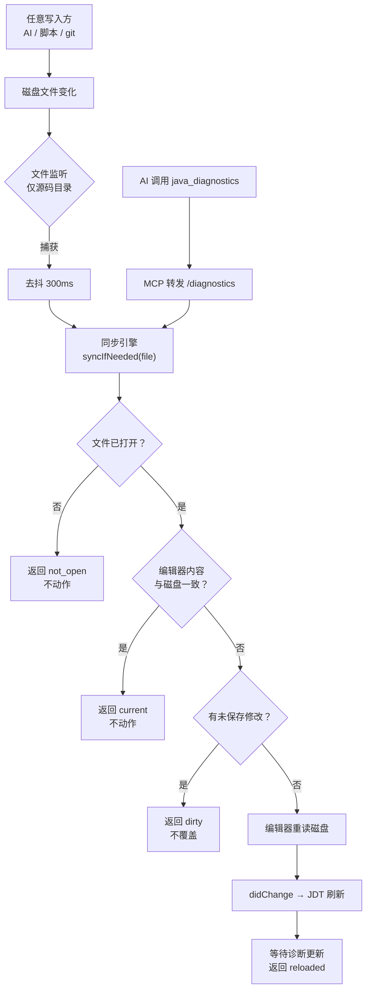
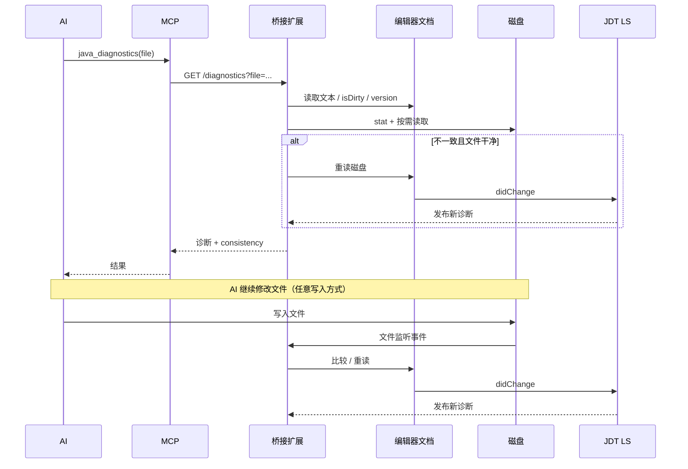

# JDT LS 缓存一致性技术方案

> 状态：已实现（扩展 `0.1.29`、MCP 插件 `0.1.10`）
> 适用仓库：`trae-java-bridge-extension`（IDE 扩展）、`trae-java-navigator`（MCP 插件）
> 目标版本：扩展 `0.1.29`、MCP 插件 `0.1.10`
> 最后更新：2026-11-21

> 说明：本文档在两个仓库各存放一份，内容保持一致。扩展侧改动见 §6–§13，MCP 侧改动见 §12。

---

## 1. 问题与结论

### 1.1 现象

同一份 Java 文件：

- 磁盘内容正确，`mvnw -DskipTests test-compile` 可以通过；
- 编辑器中打开的也是正确内容；
- 但 IDE 的 Problems 面板和 `java_diagnostics` 持续返回旧错误；
- 手动新增/删除一行再保存，错误瞬间消失。

这不是代码错误，而是 **JDT LS 内存中的文档副本与编辑器/磁盘不一致**（下文简称“文档漂移”）。

### 1.2 本次现场证据

| 证据 | 结果 |
|---|---|
| 源文件最后修改时间 | `2026-11-19 23:56:00` |
| JDT 日志 `23:55:59.641` | `12 problems reported` |
| JDT 日志 `23:56:01.831` | `15 problems reported` |
| JDT 日志 `10:18:32` | 仍为 `15 problems` |
| `mvnw -DskipTests test-compile` | 通过（退出码 0） |
| `java_search` 返回的方法行号 | 比磁盘整体偏移 1 行，且出现重复字段 |
| 对文件做一次等价编辑后 | JDT 日志 `10:37:38` 变为 `0 problems` |

最终落盘的正确内容没有触发一次新的文档同步，JDT 停在了 15 条错误的中间版本上。

### 1.3 根因

JDT LS 通过两条不同通道获取内容：

1. **文档同步**：编辑器内容变化时发送 `didOpen / didChange / didSave`，JDT 据此维护“工作副本”。
2. **文件监听**：磁盘变化时发送 `didChangeWatchedFiles`，只通知“文件变了”，不携带内容。

AI、脚本、代码生成器、`git checkout` 等直接写磁盘时，第 1 条通道不会触发；第 2 条通道在大仓库、连续写入、文件锁、排除规则等情况下可能丢失或合并。于是编辑器内容、磁盘内容、JDT 内存副本三者可能不一致。

### 1.4 上游同类问题

| 仓库 | Issue | 状态 | 说明 |
|---|---|---|---|
| redhat-developer/vscode-java | [#314](https://github.com/redhat-developer/vscode-java/issues/314) | 2017 年提出，open | CLI 构建导致 JDT LS 状态与文件系统不一致 |
| eclipse-jdtls/eclipse.jdt.ls | [#3941](https://github.com/eclipse-jdtls/eclipse.jdt.ls/issues/3941) | 2026-10 提出，open | 磁盘变化后，打开文档的诊断不重算；作者已准备修复 PR |
| eclipse-jdtls/eclipse.jdt.ls | [#824](https://github.com/eclipse-jdtls/eclipse.jdt.ls/issues/824) | open | `didChangeWatchedFiles` 同步处理，大量通知会阻塞 |
| microsoft/vscode | [#130486](https://github.com/microsoft/vscode/issues/130486) | open | LSP 模型下，跨文件派生状态不会自动刷新 |

在上游修复合并前，客户端需要自行兜底。

---

## 2. 三层模型与两条常规通道

### 2.1 三层

| 层 | 内容 | 维护者 |
|---|---|---|
| L1 编辑器文档 | 编辑器里的文本、版本号、是否未保存 | VS Code |
| L2 JDT LS | 打开文档的工作副本 + 项目资源模型 + 构建产物 + 索引 | redhat.java / JDT LS |
| L3 磁盘 | `.java` 文件的真实字节 | 文件系统 |

### 2.2 JDT 内部分成两半

| 部分 | 做什么 | 内容来源 |
|---|---|---|
| 工作副本（working copy） | 当前打开文件的补全、悬停、**单文件诊断** | L1 的 `didChange` |
| 资源模型 + JavaBuilder + 索引 | 项目结构、跨文件符号、引用、构建标记 | L3 的磁盘内容 |

因此会出现“整个项目能编译，但打开的文件满屏报错”：项目模型是对的，工作副本是旧的。

### 2.3 分叉是怎么发生的

| 写入方式 | L1 是否变化 | 是否触发 `didChange` | 结果 |
|---|---|---|---|
| AI 走编辑器编辑接口 | 是 | 是 | 工作副本立即更新 |
| 直接写磁盘，文件未打开 | 不存在 | 否 | 下次打开/构建时读取磁盘 |
| 直接写磁盘，文件打开且无未保存修改 | 通常自动重载 | 可能 | 取决于文件监听是否送达 |
| 直接写磁盘，文件打开且有未保存修改 | 否 | 否 | 工作副本继续使用旧内容 |

---

## 3. 典型场景（经典案例图）

### 3.1 场景图

以本次问题为原型：**AI 先查询报错 → 发现旧数据 → AI 继续修改文件 → 监听触发同步**。


### 3.2 真实时间线

| 时间 | 事件 | JDT 状态 |
|---|---|---|
| 23:55:59 | 文件被连续保存 | 12 条错误 |
| 23:56:01 | 又一轮保存 | 15 条错误 |
| 23:56:00 | 最终正确内容落盘 | 未再触发分析 |
| 10:18:32 | 再次校验 | 仍为 15 条 |
| 10:32:06 | Maven 编译成功 | 证明磁盘正确 |
| 10:37:38 | 对文件做一次等价编辑 | 0 条错误 |

结论：问题不在代码，也不在构建，而在“最后一次落盘没有对应的文档同步”。

---

## 4. 目标与非目标

### 4.1 目标

1. 任何写入方式（编辑器、脚本、git、生成器）都不会让 MCP 返回错误的旧诊断。
2. 一次查询就能同时得到“诊断列表”和“这份列表是否可信”。
3. 不要求 AI 改变写入方式，不新增需要 AI 主动调用的工具。
4. 不覆盖用户未保存的修改。
5. 不引入无限循环、重复构建或明显性能开销。
6. 不修改 redhat.java / JDT LS 本体。

### 4.2 非目标

1. 替代 `mvnw test-compile` 作为最终编译门禁。
2. 修复上游 JDT LS 的文档同步缺陷。
3. 每次查询都做全仓库扫描或全量构建。
4. 让 Problems 面板在无人查询时也永远实时。

---

## 5. 设计原则

1. **单一写入者**：桥接扩展是唯一执行同步的一方；MCP 只读。
2. **读时一致**：任何一次诊断查询，要么返回新鲜数据，要么明确标记 `stale / dirty / not_open`。
3. **幂等优先**：先比较，内容相同就什么都不做。
4. **脏缓冲是硬停止条件**：有未保存修改时，不重读、不覆盖。
5. **同步不反向写盘**：同步只“读磁盘、更新编辑器”，不保存文件，从根上避免循环。
6. **只处理打开的文件**：关闭的文件由 JDT 的资源模型负责。
7. **串行与去抖**：同一文件同一时间只处理一次；批量变化合并。
8. **失败可解释**：超时、冲突、桥接不可用都返回明确状态，不静默返回旧数据。

---

## 6. 总体架构与事件流转

### 6.1 组件

扩展侧新增三个内部模块：

| 模块 | 职责 |
|---|---|
| 文档注册表 | 记录打开文档、版本号、是否脏、上次同步时间 |
| 文件监听器 | 监听源码目录的 `.java` 变化，去抖后投递 |
| 同步引擎 | 比较、加锁、重读、熔断，供监听和查询共用 |

MCP 侧只做一件事：把 `/diagnostics` 返回里的新字段原样透传给 AI，不做判断、不写文件、不触发同步。

### 6.2 事件流转图



### 6.3 职责边界

| 角色 | 负责 | 不负责 |
|---|---|---|
| 扩展 | 监听、比较、重读、状态标记、可选构建 | 不判断代码是否正确 |
| MCP | 转发查询、透传状态 | 不写文件、不触发同步、不重试循环 |
| AI | 根据状态决定下一步 | 不需要适配写入方式 |

---

## 7. 一致性判定

### 7.1 判定范围

- 只处理 **已打开** 的 Java 文件。
- 只处理工作区内的源码文件。
- 关闭的文件不做比较：没有编辑器内容，JDT 以磁盘为准，`state = not_open`。

### 7.2 算法

1. 取编辑器文档的文本、版本号、`isDirty`。
2. 对磁盘文件做 `stat`，比较 `mtime + size`；与上次记录相同则直接判定一致（快速路径）。
3. 快速路径未命中时，读取磁盘内容，按 UTF-8 解码。
4. **统一换行符后**比较文本；只比较语义内容，避免 CRLF/LF 造成误判。
5. 一致 → `current`；不一致 → 进入同步动作。

### 7.3 状态表

| 状态 | 含义 | 诊断是否可信 |
|---|---|---|
| `current` | 编辑器内容与磁盘一致 | 是 |
| `reloaded` | 刚刚重读过磁盘 | 是 |
| `dirty` | 文件有未保存修改，未做同步 | 只代表编辑器内容 |
| `not_open` | 文件未打开，诊断来自磁盘模型 | 通常是 |
| `unknown` | 检查失败（超时、桥接异常等） | 否 |

### 7.4 为什么不做全仓逐文件扫描

几千个文件逐个 `stat + hash` 成本不可接受，而且没有打开的文件不存在工作副本分叉。工作区级结果改用监听记录的变化集合（见 §11）。

---

## 8. 同步动作

### 8.1 首选：让编辑器重读磁盘

- 调用 `workbench.action.files.revert`（传入目标文件 URI）。
- 只更新编辑器文本模型，**不写磁盘**。
- 编辑器内容变化触发 `didChange`，JDT 更新工作副本并重新分析。

### 8.2 兜底：整篇替换

如果目标 IDE 版本不支持对非活动编辑器执行 `revert`：

- 读取磁盘内容；
- 用 `WorkspaceEdit` 替换整篇文本；
- 随后保存，使缓冲区不保持脏状态；
- 保存前记录“本次写入的哈希”，监听再次触发时直接忽略。

该路径会写盘，必须额外满足：内容与磁盘字节一致、换行符已统一、带冷却与熔断。

### 8.3 等待诊断刷新

- 重读成功后，等待 `onDidChangeDiagnostics` 触发；
- 去抖窗口 300–800ms，超时 2 秒；
- 超时则返回 `state = reloaded` + `stale = true`，不无限等待；
- 监听路径不逐个等待诊断：批量重读后由一次增量构建统一刷新（见 §11）。

### 8.4 伪代码

```text
syncIfNeeded(uri):
  if not open(uri): return not_open
  doc = document(uri)
  if doc.isDirty: return dirty
  if diskUnchangedSinceLastCheck(uri): return current
  if normalized(doc.text) == normalized(readDisk(uri)):
      rememberHash(uri); return current
  acquireLock(uri)
  try:
      recheckDirtyAndVersion(doc)
      revertOrReplace(uri)
      waitForDiagnostics(uri, timeout=2s)
      return reloaded
  finally:
      releaseLock(uri)
```

---

## 9. 时序图



要点：

- 查询路径和监听路径调用同一个同步函数；
- 查询路径不依赖“刚刚是否写过文件”；
- 监听路径不依赖 MCP 是否在查询；
- 任何一条路径先完成，另一条看到内容一致就直接结束。

---

## 10. 冲突、循环与熔断

### 10.1 风险与对策

| 风险 | 对策 |
|---|---|
| 监听与查询同时处理同一文件 | 每文件一把锁，后到者等待同一结果 |
| 用户正在输入 | 应用前再次检查 `isDirty` 与版本号，脏则放弃 |
| 多个 MCP 客户端并发 | 扩展端串行队列，同一文件请求合并 |
| 连续保存引发反复重读 | 300ms 去抖 + 哈希相同不动作 |
| 同步反向写盘造成循环 | 首选只读重载；兜底路径记录预期哈希并加冷却 |
| 构建产物触发监听 | 监听只覆盖源码目录，排除 `target/build/out/node_modules` |
| 自己触发自己 | 扩展自身操作产生的事件按“预期变更”忽略 |
| 频繁构建 | 单飞构建 + 空闲去抖 + 可关闭 |

### 10.2 循环为什么不会发生

```
文件变化 → 监听 → 去抖 → 比较 → 最多一次重读 → 结束
```

- 重读只读磁盘，不写磁盘，不产生新的文件变化；
- 下一轮比较内容一致，立即结束；
- 监听范围排除构建输出，构建不会反向触发同步。

### 10.3 熔断规则

- 同一文件 10 秒内同步超过 3 次：暂停该文件的自动同步；
- 记录日志与状态，等下一次内容真正变化后恢复；
- 任何一次同步失败不自动重试，只标记 `unknown`。

---

## 11. 项目级刷新

单文件查询只修复该文件的工作副本，不保证整个项目的构建标记最新。项目级采用“记录 + 按需”：

1. 监听发现变更文件未打开时，只记入 `projectDirty` 集合；
2. `/diagnostics` 工作区模式返回 `needsRefresh`、`dirtySince`、`refreshHint` 与最多 20 个变化文件名；
3. 可选：外部变更停止 2 秒后，触发一次增量构建（`java.workspace.compile`，参数 `false`）；构建返回成功只代表命令未报错，必须再等本批文件出现诊断变化（`refreshSettleMs`，默认 3 秒）才算刷新生效；
4. 增量构建没有带来任何诊断变化时（JDT 漏掉 `didChangeWatchedFiles` 的典型表现），自动升级为完整重载 `java.projectConfiguration.update`（传根目录 `pom.xml` / `build.gradle` URI），重建资源模型与索引；新建/删除文件即使已在编辑器打开，也必须计入项目级刷新；
5. 变更文件数达到 50（常量 `AUTO_CONFIG_MIN_FILES`）时直接使用完整重载，修复批量移动/重命名后的资源模型错位；
6. 刷新未确认（重载等待诊断静默超时）时保留 `projectDirty`：状态栏继续显示 `待刷新(N)`，且不再自动重试，直到下一次外部变化；已从磁盘删除的文件不计入待刷新；
7. 显式入口 `GET /refresh?mode=auto|build|config&timeout=`：`build` 增量编译，`config` 完整重载，`auto` 按 `projectDirty` 规模选择、构建失败时自动升级；重载以诊断变化后的静默窗口作为完成信号，超时返回 `completed=false`；
8. 构建/重载单飞：同一时间只允许一个，期间的新变化合并到下一轮，两次刷新最小间隔 5 秒；只清理发起时的那一批文件，刷新期间新到的变化保持待刷新；
9. 不自动执行全量构建，不自动清缓存。

---

## 12. 返回结构（Agent 友好）

### 12.1 单文件

```json
{
  "scope": "file",
  "file": "...",
  "severity": "warning",
  "missing": false,
  "total": 37,
  "allTotal": 53,
  "summary": {
    "bySeverity": { "warning": 37 },
    "bySource": { "sonarqube": 37 },
    "byLanguage": { "java": 37 },
    "byCode": { "sonarqube:java:S1192": 26, "sonarqube:java:S3776": 1 }
  },
  "workspaceTotals": {
    "total": 188,
    "bySeverity": { "error": 8, "warning": 180 },
    "bySource": { "Java": 8, "sonarqube": 180 },
    "byLanguage": { "java": 40, "js": 148 }
  },
  "items": [],
  "consistency": {
    "state": "reloaded",
    "stale": false,
    "dirty": false,
    "reloaded": true,
    "reason": null
  },
  "source": "ide-bridge",
  "workspace": "..."
}
```
`total` 只统计本次 `severity` 过滤后的条目，`allTotal` 才是该文件全部级别的条目数；`summary` 由服务端直接给出计数，调用方不需要再数 `items`；`workspaceTotals` 是整个工作区的残留计数（`bySource` 区分 `Java`/`sonarqube`，`byLanguage` 区分文件类型），文件 `total=0` 不代表工作区清零。

### 12.2 工作区

```json
{
  "scope": "project",
  "severity": "error",
  "total": 3,
  "allTotal": 17,
  "skippedMissing": 0,
  "missingFiles": [],
  "missingTruncated": false,
  "summary": {
    "bySeverity": { "error": 3 },
    "bySource": { "Java": 3 },
    "byCode": { "Java:268435846": 2, "Java:16777218": 1 }
  },
  "items": [],
  "consistency": {
    "state": "stale",
    "needsRefresh": true,
    "changedFiles": ["A.java", "B.java"],
    "truncated": false,
    "dirtySince": "2026-11-20T07:12:00.000Z",
    "refreshHint": "java_diagnostics {refresh:\"auto\"}；仍陈旧时用 refresh:\"config\" 强制完整重载"
  },
  "source": "ide-bridge",
  "workspace": "..."
}
```
文件被移动或删除后，JDT/Sonarqube 可能在 Problems 面板里留下指向旧路径的条目；工作区模式会过滤这些已不存在文件的诊断，并通过 `skippedMissing` / `missingFiles` 报告数量，文件模式对缺失文件返回 `missing=true`、`total=0`。面板中的幽灵条目只能由发布它的扩展清除，必要时重载窗口。

### 12.3 Agent 约定

| 状态 | AI 应如何处理 |
|---|---|
| `current` | 正常使用诊断结果 |
| `reloaded` | 正常使用，说明刚刚已同步 |
| `dirty` | 不要下结论；提示用户保存或放弃修改 |
| `not_open` | 结果来自磁盘模型，可正常使用 |
| `unknown` | 不要下结论；说明检查失败原因 |
| `needsRefresh` | 项目级结果可能滞后，必要时提示或稍后重查 |

上述约定写入 `java_diagnostics` 的工具描述与 `java-navigate` 技能文档。

---

## 13. 配置项

| 配置 | 默认 | 说明 |
|---|---|---|
| `traeJavaBridge.sync.enabled` | `true` | 总开关；关闭后行为与当前版本一致 |
| `traeJavaBridge.sync.debounceMs` | `300` | 监听去抖窗口 |
| `traeJavaBridge.sync.cooldownMs` | `800` | 同一文件同步后的冷却时间 |
| `traeJavaBridge.sync.maxPer10s` | `3` | 单文件 10 秒内最大同步次数，超过熔断 |
| `traeJavaBridge.sync.timeoutMs` | `2000` | 等待诊断刷新上限 |
| `traeJavaBridge.watch.exclude` | `target/build/out/node_modules/.git` | 监听排除目录 |
| `traeJavaBridge.project.autoBuild` | `true` | 外部变更后是否空闲增量构建（单飞，两次构建最小间隔 5 秒） |
| `traeJavaBridge.notifyAfterErrors` | `3` | 连续请求失败多少次后弹通知 |
| `traeJavaBridge.sync.maxFileSizeKb` | `2048` | 超过该大小的文件跳过一致性比较 |
| `traeJavaBridge.sync.revertTimeoutMs` | `5000` | revert 命令超时 |
| `traeJavaBridge.sync.selfWriteGraceMs` | `1500` | 兜底写盘后忽略自身监听事件的时长 |
| `traeJavaBridge.project.autoBuildIdleMs` | `2000` | 变更停止多久后自动刷新 |
| `traeJavaBridge.project.autoBuildMinGapMs` | `5000` | 两次自动刷新的最小间隔 |
| `traeJavaBridge.project.autoConfigMinFiles` | `50` | 批量变更达到该文件数时升级为完整重载 |
| `traeJavaBridge.project.buildTimeoutMs` | `120000` | 增量编译超时 |
| `traeJavaBridge.project.reloadTimeoutMs` | `15000` | 完整重载等待诊断静默的上限 |
| `traeJavaBridge.project.reloadQuietMs` | `800` | 诊断静默窗口 |
| `traeJavaBridge.project.refreshSettleMs` | `3000` | 增量编译后等待本批文件诊断更新的上限；无变化则升级完整重载 |
| `traeJavaBridge.project.changedFilesLimit` | `20` | `changedFiles` 最大返回数 |
| `traeJavaBridge.project.dirtyMaxFiles` | `2000` | `projectDirty` 最大跟踪数 |

设置面板按 **基础 / 诊断同步 / 项目刷新** 三组展示（`contributes.configuration` 使用带纯标题的数组，块标题都不要等于扩展显示名）。

---

## 14. 可观测性

- `/health` 增加同步统计：`activity`、`lastSyncAt`、`lastSyncFile`、`reloadedCount`、`dirtyConflicts`、`noopChecks`、`circuitBroken`、`lastBuildAt`、`lastBuildMode`、`lastModelRefreshAt`、`projectDirty`；
- 状态栏文字实时显示 `正常 / 同步中 / 构建中 / 重载中 / 待刷新(N) / 异常 / 离线`，端口与详细统计放在悬浮提示；
- 扩展输出通道记录：比较结果、动作、耗时、失败原因；
- MCP 的 `java_status` 可展示桥接同步统计。

---

## 15. 错误处理与边界

| 情况 | 行为 |
|---|---|
| 桥接不可用 | MCP 回退到独立 JDT LS；状态标记 `source = standalone-jdtls` |
| redhat.java 未就绪 | 返回 `unknown`，不重试风暴 |
| `revert` 失败 | 尝试兜底路径；仍失败则 `unknown` |
| 文件被删除/重命名 | 返回 `not_open` 或 `unknown`，由 JDT 监听处理资源模型 |
| 非 UTF-8 文件 | 不强行解码；返回 `unknown`，不误判 |
| 超大文件 | 跳过哈希，返回 `unknown`，避免阻塞 |
| 远程开发 | 扩展在远端，行为一致；桥接目录需共享 |
| 多个窗口 | 桥接文件按工作区 + 进程隔离，互不影响 |

---

## 16. 测试方案

### 16.1 单元测试

- 文本比较：相同、仅换行符不同、编码不同、超大文件；
- 状态机：`current / reloaded / dirty / not_open / unknown`；
- 去抖、锁、冷却、熔断；
- 监听排除规则。

### 16.2 集成测试

- 启动扩展测试宿主，打开临时 Java 工作区；
- 模拟编辑器编辑、磁盘直写、脏缓冲三种情况；
- 断言返回的 `consistency.state` 与诊断条数。

### 16.3 手工/E2E 矩阵

| 场景 | 预期 |
|---|---|
| AI 用编辑器工具改文件 | `current`，诊断立即更新 |
| Python 直写、文件已打开且干净 | 监听或查询触发同步，`reloaded` |
| Python 直写、文件打开且有未保存修改 | `dirty`，不覆盖 |
| 连续快速保存多次 | 去抖后只同步一次 |
| `git checkout` 切换文件 | 监听同步，或查询时补同步 |
| 构建生成 `target/generated-sources` | 不触发同步 |
| 文件被删除 | 不报错，状态明确 |
| 桥接关闭 | 回退独立 JDT LS，行为可预期 |

### 16.4 验收标准

1. 上述矩阵全部通过；
2. 同一文件 10 秒内同步次数不超过 3；
3. 查询 P95 延迟增加不超过 50ms（未发生同步时）；
4. 不出现无限循环、重复构建、脏缓冲被覆盖。

---

## 17. 发布与兼容

- 扩展版本：`0.1.24 → 0.1.25`；
- MCP 插件版本：`0.1.6 → 0.1.7`；
- 返回字段为**新增**，旧版 MCP 可忽略，不破坏兼容；
- 默认开启同步；可通过 `traeJavaBridge.sync.enabled = false` 回到旧行为；
- 发布说明中注明：这是客户端兜底，不替代 Maven 编译门禁。

---

## 18. 风险与开放问题

1. 不同 VS Code 版本对非活动编辑器执行 `revert` 的行为可能不同，需要实测并保留兜底路径。
2. 远程开发与多窗口场景下，桥接目录与文件可见性需要额外验证。
3. 项目级增量构建是否默认开启，需要根据大仓库实测决定。
4. 上游 #3941 合并后，可评估是否关闭部分客户端兜底逻辑。
5. 其他语言服务（TypeScript、Rust）是否有同样问题，不在本方案范围。

---

## 19. 参考

- [vscode-java #314 — External clean build gets jdt.ls out-of-sync](https://github.com/redhat-developer/vscode-java/issues/314)
- [eclipse.jdt.ls #3941 — Open documents keep stale diagnostics after files change on disk](https://github.com/eclipse-jdtls/eclipse.jdt.ls/issues/3941)
- [eclipse.jdt.ls #824 — Performance issues when adding lots of files](https://github.com/eclipse-jdtls/eclipse.jdt.ls/issues/824)
- [microsoft/vscode #130486 — Stale semantic tokens across several files](https://github.com/microsoft/vscode/issues/130486)
- [VS Code Java FAQ](https://code.visualstudio.com/docs/java/java-faq)